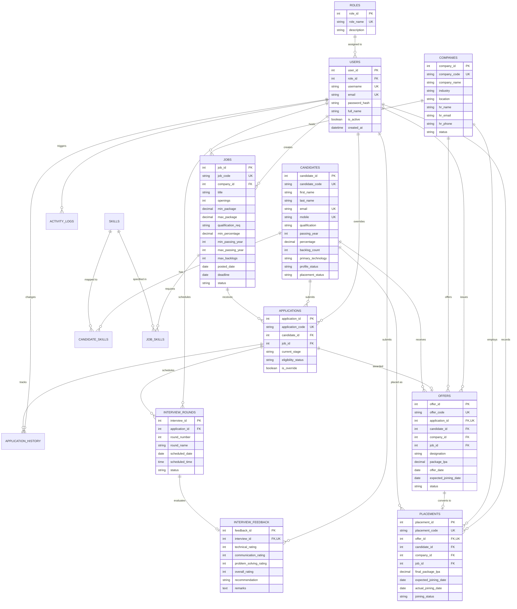

# Recruitment & Placement Management System (RPMS)

A complete, production-ready, database-backed web application built for training institutes, colleges, and placement organizations to manage candidates, corporate partners, job drives, automated eligibility checks, multi-round interview schedules, interviewer rating feedback, transactional job offers, joining confirmations, placement metrics, and analytics.

---

## 🌟 Key Features

1. **Role-Based Access Control (RBAC):**
   - **Admin:** Complete system visibility, master configurations, user access management, and activity audit trails.
   - **Recruiter:** Job drive creation, candidate application processing, interview round scheduling, and feedback entry.
   - **Placement Officer:** Candidate eligibility verification, company partnership management, offer issuance, and joining outcome tracking.
   - Password hashes stored securely via Werkzeug's `scrypt` hashing algorithm (no plaintext passwords).

2. **Dashboard Overview:**
   - Real-time aggregate indicators queried live from the database:
     - Total & Active Candidates, Confirmed Placed Students
     - Partner Companies & Open Job Vacancies
     - Offers Issued & Acceptance Rates
     - Average Placed CTC Package
     - Applications breakdown by pipeline stage
     - Upcoming interview schedule and selected candidates awaiting offers

3. **Candidate Management:**
   - Complete personal, contact, location, and academic records (Degrees, Universities, Passing Years 1990–2035, Percentages, CGPA, Backlog counts).
   - Technology stack tagging with individual proficiency levels (Beginner, Intermediate, Advanced, Expert).
   - Strict validation: Percentage bounded between `0.00%` and `100.00%`, non-negative backlogs, unique candidate code, email, and mobile numbers.
   - Soft-deactivation to preserve historical placement records and audit trails without data loss.

4. **Company & Job Drive Management:**
   - Company profiles with HR campus relations details, industry categorization, and website links.
   - Job drive postings with opening quotas (`openings > 0`), salary package bounds (`min_package <= max_package`), academic percentage thresholds, passing year ranges, backlog ceilings, and deadline validation (`deadline >= posted_date`).
   - Mandatory and optional skill requirements with minimum proficiency levels.
   - Close or cancel job drives without breaking historical candidate applications.

5. **Eligibility Evaluation & Applications:**
   - Real-time eligibility evaluation engine checking:
     - Candidate active status
     - Job open status & unexpired deadline
     - Duplicate application prevention
     - Degree qualification matching (or 'Any')
     - Minimum percentage threshold
     - Eligible passing year batch
     - Active backlog ceiling
     - Mandatory technical skills & proficiency levels
   - Interactive AJAX eligibility feedback showing `ELIGIBLE` or `NOT_ELIGIBLE` with comprehensive itemized reasons.
   - Authorized staff override workflow with audited justifications.
   - Strict state machine progression:
     ```
     APPLIED → ELIGIBILITY_VERIFIED → SHORTLISTED → INTERVIEW_SCHEDULED → INTERVIEWED → SELECTED → OFFERED → JOINED
     ```
     With branching to `REJECTED` or `WITHDRAWN`. Direct illegal jumps (e.g. `APPLIED → JOINED`) are strictly blocked.
   - Complete timestamped application history log for every stage change.

6. **Interviews & Multi-Round Feedback:**
   - Schedule rounds (Aptitude, Technical, Managerial, HR) with dates, times, modes (Online / In-person), interviewer panels, and meeting links.
   - Reschedule or mark no-show outcomes.
   - Multi-metric evaluation (Technical, Communication, Problem-Solving, and Overall ratings on a 1–5 scale).
   - Formal recommendations (`NEXT_ROUND`, `SELECTED`, `REJECTED`, `ON_HOLD`), automatically updating application stage.
   - Enforced single feedback entry per interview round.

7. **Transactional Offers & Placements:**
   - Issue job offers with designations, CTC in LPA, offer dates, and expected joining dates.
   - Multi-step database transactions:
     - Offer creation atomically updates application stage to `OFFERED` and adds history.
     - Confirmed joining atomically records placement, transitions application to `JOINED`, updates candidate status to `Placed`, and logs history.
     - All related updates roll back automatically if any step encounters an error.

8. **Database-Backed Reports Hub:**
   - Candidates by Technology breakdown with percentage share
   - Open Jobs and Vacancies by Company
   - Application Pipeline Distribution
   - Full Recruitment Funnel with conversion rates
   - Company-Wise and Technology-Wise Placements with package averages and highs
   - Recruiter Performance and throughput metrics
   - Pending & Upcoming Interview Calendar
   - Offer-to-Joining Conversion Ratios
   - Open Job Aging (days since posted)
   - Placed vs. Unplaced Ratio

9. **Activity Audit Trail:**
   - Immutable audit logging for all critical operations (user, module, action, record ID, description, timestamp, IP address).

---

## 🗄️ Database Architecture & ER Diagram



---

## 💻 Tech Stack & Architecture

- **Backend:** Python 3.10+ & Flask
- **Database Engine:** MySQL (via `mysql-connector-python`) with SQLite support for instant local evaluation
- **Templating:** Jinja2 + HTML5 + CSS3 (custom responsive variables, no bulky third-party JS frameworks)
- **Security:** Werkzeug password security, CSRF protection on state-changing operations, parameterized queries
- **Testing:** Pytest

### Directory Structure

```text
├── app.py                      # Application startup, routing, session & CSRF controllers
├── config.py                   # Environment configuration loader
├── requirements.txt            # Python dependencies
├── .env.example                # Environment variables template
├── placement.db                # Turnkey SQLite database file (initialized with sample data)
├── sql/
│   ├── schema.sql              # Normalized MySQL DDL schema script
│   ├── sample_data.sql         # Rich MySQL seed data script
│   └── init_database.py        # Automated initialization utility (MySQL or SQLite)
├── models/
│   ├── user.py                 # User & Role dataclasses
│   ├── candidate.py            # Candidate dataclass
│   ├── company.py              # Company dataclass
│   ├── job.py                  # Job Opening dataclass
│   ├── application.py          # Application dataclass & Stage State Machine
│   ├── interview.py            # Interview Round & Feedback dataclasses
│   ├── offer.py                # Job Offer dataclass
│   └── placement.py            # Placement & Joining Outcome dataclass
├── dao/
│   ├── db.py                   # Parameterized SQL connection manager & transaction handler
│   ├── user_dao.py             # User authentication and role queries
│   ├── candidate_dao.py        # Candidate persistence & skills queries
│   ├── company_dao.py          # Company persistence queries
│   ├── job_dao.py              # Job persistence & skills requirements queries
│   ├── application_dao.py      # Application stage & history queries
│   ├── interview_dao.py        # Interview round & feedback queries
│   ├── offer_dao.py            # Offer generation & status queries
│   ├── placement_dao.py        # Placement & joining outcome queries
│   ├── activity_dao.py         # Audit logging queries
│   └── report_dao.py           # Dashboard aggregates and 11 SQL reports
├── services/
│   ├── exceptions.py           # Custom domain exception classes
│   ├── auth_service.py         # Password hashing & verification
│   ├── candidate_service.py    # Candidate business validation rules
│   ├── company_service.py      # Company management business rules
│   ├── job_service.py          # Job drive criteria validation rules
│   ├── eligibility_service.py  # Candidate eligibility evaluation engine
│   ├── application_service.py  # Application lifecycle state machine
│   ├── interview_service.py    # Interview scheduling & feedback rules
│   └── offer_service.py        # Multi-step transactional offer/placement service
├── templates/                  # Modular Jinja2 HTML templates
│   ├── base.html               # Common layout with navigation sidebar & topbar
│   ├── login.html              # Authentication page with demo quick-fill
│   ├── dashboard.html          # Operational dashboard with live metrics
│   ├── candidates/             # List, add/edit form, and candidate detail view
│   ├── companies/              # List, add/edit form, and company detail view
│   ├── jobs/                   # List, add/edit form, and job detail view
│   ├── applications/           # List, interactive apply screen, and detail view
│   ├── interviews/             # Rounds calendar, scheduling form, feedback form
│   ├── offers/                 # Offer list, issue offer form, placement confirmation
│   ├── reports/                # Analytics hub with 11 database-backed reports
│   └── activity_logs.html      # Filterable system audit logs view
├── static/
│   ├── css/style.css           # Responsive styling and design system
│   └── js/main.js              # Real-time AJAX eligibility preview & client helpers
└── tests/                      # Automated unit and integration tests
    ├── conftest.py             # Pytest configuration and database fixtures
    ├── test_candidate_validation.py
    ├── test_job_validation.py
    ├── test_eligibility.py
    ├── test_application_transitions.py
    ├── test_offer_placement_workflow.py
    ├── test_duplicate_rejection.py
    └── test_web_routes.py
```

---

## 🚀 Setup & Installation Instructions

### 1. Prerequisites
- Python 3.10 or higher
- Optional for MySQL Mode: MySQL Server 8.0+ or MariaDB

### 2. Clone and Setup Virtual Environment
```bash
# Navigate to project directory
cd "projact 1"

# Create a virtual environment (recommended)
python -m venv venv

# Activate virtual environment
# Windows (PowerShell):
.\venv\Scripts\Activate.ps1
# Linux / macOS:
source venv/bin/activate

# Install required dependencies
pip install -r requirements.txt
```

### 3. Configure Database
Copy `.env.example` to `.env`:
```bash
copy .env.example .env
```

#### Option A: Running with SQLite (Turnkey / Zero Setup)
In `.env`:
```ini
DB_ENGINE=sqlite
SQLITE_DB_PATH=placement.db
```
Initialize the database with schema and sample data:
```bash
python sql/init_database.py
```

#### Option B: Running with MySQL
1. Ensure your local MySQL server is running (e.g. on port 3306).
2. Configure `.env`:
   ```ini
   DB_ENGINE=mysql
   DB_HOST=localhost
   DB_PORT=3306
   DB_USER=root
   DB_PASSWORD=your_mysql_password
   DB_NAME=placement_db
   ```
3. Initialize the MySQL database:
   ```bash
   python sql/init_database.py
   ```
   *Alternatively, you can import `sql/schema.sql` followed by `sql/sample_data.sql` directly via MySQL Workbench or the MySQL command line client:*
   ```bash
   mysql -u root -p < sql/schema.sql
   mysql -u root -p placement_db < sql/sample_data.sql
   ```

### 4. Run the Application
```bash
python app.py
```
Open your browser and navigate to:
```
http://localhost:5000
```

---

## 🔑 Demo User Credentials

The application is seeded with 3 demo accounts across all three supported roles. Each user can be autofilled with one click from the login screen:

| Role | Username | Password | Full Name / Description |
| :--- | :--- | :--- | :--- |
| **Admin** | `admin` | `Demo@123` | Dr. Rajesh Sharma (Director) — Full system access & audit logs |
| **Recruiter** | `recruiter` | `Demo@123` | Priya Menon (Lead Recruiter) — Jobs, applications & interviews |
| **Placement Officer** | `placement` | `Demo@123` | Vikram Rathore (Placement Officer) — Offers, placements & reports |

*(All passwords are encrypted with `scrypt` hashes in the database.)*

---

## 🧪 Running Automated Tests

Run the complete test suite with verbose output:
```bash
pytest -v
```

### Test Coverage Highlights:
- **`test_candidate_validation.py`**: Percentage bounds (0–100), backlog count validation, soft-deactivation.
- **`test_job_validation.py`**: Positive openings quota, salary range consistency, deadline chronometry, active company checks.
- **`test_eligibility.py`**: Multi-rule criteria assessment, inactive candidate disqualification, missing skill & proficiency detection.
- **`test_application_transitions.py`**: Pipeline state machine, valid step progressions, blocking of invalid state jumps.
- **`test_offer_placement_workflow.py`**: Transactional offer generation, duplicate offer blocking, atomic placement joining outcome synchronization.
- **`test_duplicate_rejection.py`**: Database & application level rejection of duplicate emails, mobile numbers, and duplicate applications.
- **`test_web_routes.py`**: Full HTTP integration test for all authenticated views and redirects.

---

## 🛡️ Security & Reliability Implementations

1. **SQL Injection Prevention:** Every query in the DAO layer uses strict parameterized placeholders (`%s` / `?`). User input is never concatenated into SQL strings.
2. **CSRF Protection:** Secure session-bound tokens are generated and verified on all state-altering (`POST`) submissions.
3. **Password Security:** Hashes generated using `werkzeug.security.generate_password_hash` with modern key derivation.
4. **Data Integrity:** Historical candidates, partner companies, and job drives with associated applications are soft-deactivated/closed rather than deleted.
5. **ACID Transactions:** Offer generation and placement joining confirmations use database transactions (`db_transaction()`) ensuring multi-table consistency and automatic rollback on failure.

